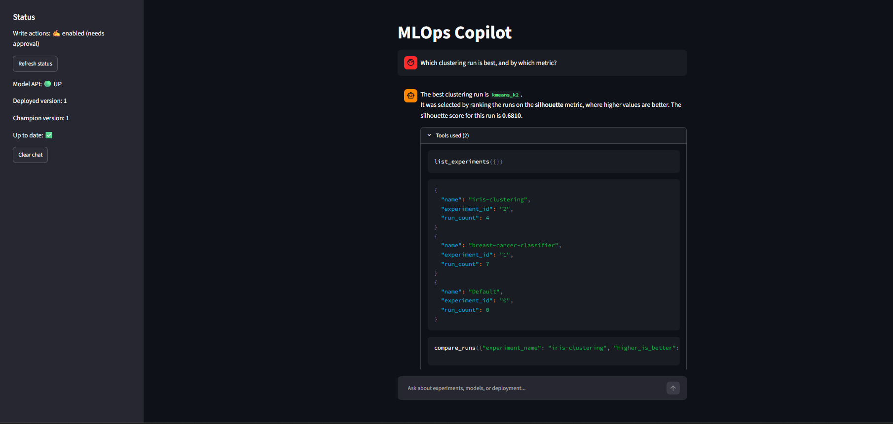
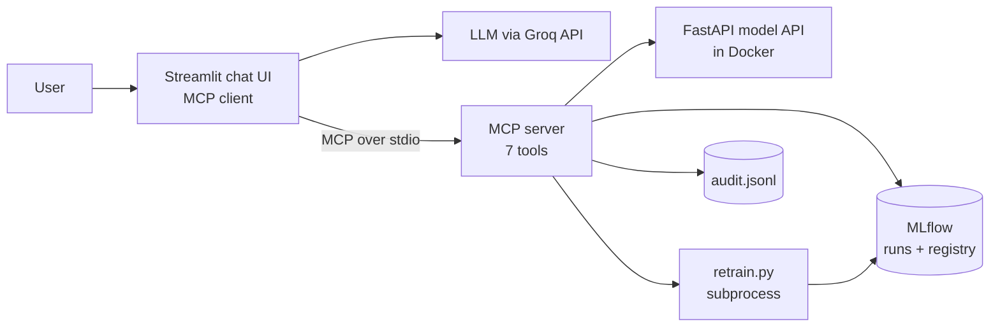

# MLOps Copilot

An AI assistant that can look at your ML experiments, model registry and deployment, and can retrain a model **only after a human clicks Approve**.

It is built around a custom **MCP (Model Context Protocol) server** that exposes an MLflow-based ML workflow as 7 tools. A Streamlit chat app connects an LLM to those tools.

> Demo video: [TODO: add link]

## What it does

You can ask things like:

- *"Which breast cancer run has the best F1?"*
- *"Which clustering run is best, and by which metric?"*
- *"Is the deployed model up to date?"*
- *"Retrain with 20 trees and depth 3."* (shows a preview and waits for your approval)

 <!-- TODO: add a screenshot -->

## Architecture



| Layer | Technology |
|---|---|
| Experiment tracking and model registry | MLflow (SQLite backend) |
| Tool layer | MCP Python SDK (pinned to `mcp<2`) |
| Model serving | FastAPI + Docker |
| LLM | Any OpenAI-compatible API (tested with Groq, `openai/gpt-oss-20b`) |
| UI | Streamlit |
| Tests | pytest |

## The 7 tools

| Tool | Type | Purpose |
|---|---|---|
| `list_experiments` | read | List experiments and run counts |
| `compare_runs` | read | Rank finished runs by a metric |
| `list_registered_models` | read | List registered models and aliases |
| `get_model_info` | read | Versions, metrics and the `champion` alias of one model |
| `check_deployment_status` | read | Is the model API up, and does it serve the champion version? |
| `get_logs` | read | Read the audit log or the API container logs |
| `trigger_retrain` | **write** | Retrain and register a new model version (approval required) |

## Safety design

The only write action is retraining, and it is guarded in layers:

1. **Read-only by default.** Writes are blocked unless `MLOPS_READ_ONLY=false` is set in `.env`.
2. **Preview, then confirm.** The first call returns a preview and a single-use token that expires after 5 minutes and only works for the exact same parameters.
3. **The model never sees the token.** The token field is removed from the tool schema the LLM receives. The app holds the token and only sends it after a human clicks **Approve**.
4. **Bounded inputs.** Trees: 10-500. Depth: 1-30.
5. **No automatic promotion.** A retrain registers a *new version*. It does not change the `champion` alias or the deployed model.
6. **Audit log.** Every attempt (blocked, previewed, rejected, started, completed, failed) is appended to `logs/audit.jsonl`.
7. **Token redaction.** `get_logs` hides tokens, so the model cannot read one and approve its own action.

Eight automated tests (`pytest`) cover these rules.

## Evaluation

Tool-selection check on 12 questions, 3 runs each, with `openai/gpt-oss-20b` (October 2026):

**35 / 36 correct (97%).**

- 8 read-only questions (experiments, runs, models, deployment, logs): 24/24 correct, including the arguments.
- Retrain request: 2/3. On one run, the model made no tool call.
- 3 negative cases (promote a model, delete everything, an off-topic question): 9/9. The model correctly used no tool.

Method: a fresh conversation per question, up to 4 model steps, read-only tools executed, `trigger_retrain` never executed. A case passes when the model calls the expected tool with the expected arguments (or calls no tool in the negative cases).

Full table: [`docs/eval_results.md`](docs/eval_results.md). Run it yourself: `python tests/eval_tool_selection.py`.

**A note on the method.** My first version judged only the model's *first* tool call and scored 30/36. It wrongly penalized the model for first listing experiments to find their exact names, which is sensible behavior. I changed the method to judge the short flow. The score difference comes from fixing the test, not from improving the model.

## Quick start

Developed on Windows (Git Bash), Python 3.13, Docker Desktop.

```bash
# 1. Environment
python -m venv .venv
source .venv/Scripts/activate        # Mac/Linux: source .venv/bin/activate
pip install -r requirements.txt

# 2. Train sample models and log them to MLflow
python training/train_supervised.py
python training/train_unsupervised.py

# 3. Register the best runs and mark them as champion
python training/register_best.py

# 4. Export the champion and start the model API
#    (api/requirements.txt pins scikit-learn; keep it equal to the version used for training)
python api/export_champion.py
docker compose up -d --build        # model API on :8000

# 5. Settings: create a .env file in the project root
#    MLOPS_READ_ONLY=false
#    GROQ_API_KEY=your_key_here
#    LLM_MODEL=openai/gpt-oss-20b

# 6. Start the app
streamlit run client/app.py
```

Optional:

```bash
docker compose --profile ui up -d    # MLflow UI on :5000 (stop a host `mlflow ui` first)
mlflow ui --backend-store-uri sqlite:///mlflow.db                    # or run the UI on the host instead
npx @modelcontextprotocol/inspector python server/mlflow_server.py   # test tools without an LLM
pytest -q                                                            # safety tests
```

The optional MLflow UI mounts the SQLite file read-only. In testing, runs and versions written by the host showed up after refreshing the browser page, with no container restart. Model artifact files can’t be opened inside the container, because the database stores host file paths.

To use another provider, set `LLM_BASE_URL`, `LLM_API_KEY` and `LLM_MODEL`.

## Project structure

```
training/   training scripts, register_best.py, retrain.py
server/     MCP server (7 tools, safety logic, audit log)
api/        FastAPI model service and Dockerfile
client/     assistant.py (terminal) and app.py (Streamlit)
tests/      pytest safety tests and the tool-selection evaluation
docs/       evaluation results
```

## Problems solved along the way

- **Subprocess hang on Windows.** The retrain script finished in seconds when run by hand, but hung until timeout when launched from the MCP server. Giving the child process its own empty stdin and redirecting its output to files fixed it.
- **Model aliases showed up empty.** Alias data lives on the registered model, not on its version objects. The tool now reads and inverts it.
- **Evaluation flaw** described above.
- **Slow container builds.** `pip` timed out on a slow connection; raised the timeout and retries in the Dockerfile.

## Limitations

- Retraining and serving cover one model and one sample dataset, which is a demo of the workflow rather than a production pipeline.
- The confirmation tokens are kept in the memory of the server process, so they are lost if it restarts (they would expire after 5 minutes anyway).
- The deployed model is baked into the Docker image, so serving a new version needs a re-export and rebuild.
- No user authentication or multi-user support. The server runs locally over stdio.
- The assistant has no tool to promote a model or change the champion alias. That step is deliberately left to a human.
- The evaluation checks tool selection only. It does not check whether the final answer is faithful to the tool output. In testing, the model sometimes used loose wording such as calling one run "better" when two scores were tied.
- Model behavior varies between runs, and the sample (36 checks) is small.

## Possible next steps

- A `promote_model` tool with the same preview and approval flow.
- An answer-faithfulness check in the evaluation.
- Docker Compose for the model API and the MLflow UI.
- Authentication and a shared (non-local) MLflow backend.
